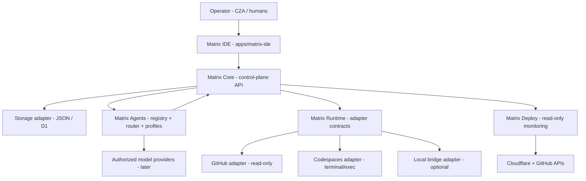
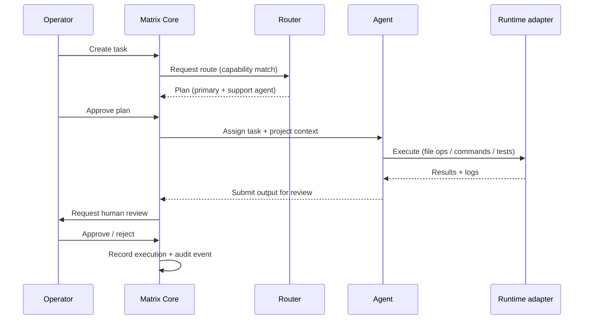
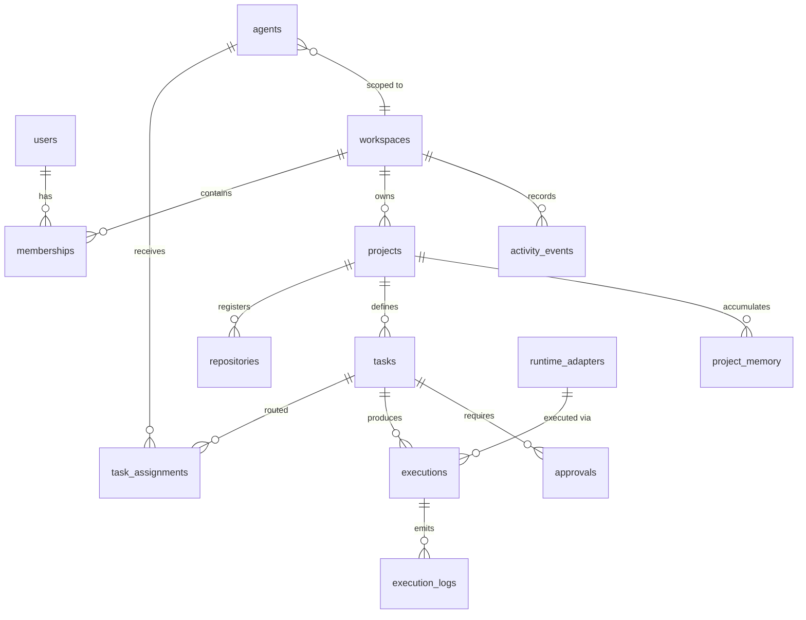

# RADARMatrix — Phase 0 Discovery Report & Phase 1 Architecture

**Product:** RADARMatrix — AI Development Operating System / Agent Orchestration Platform
**Organization:** RADARCharts by REM · **Owner:** CZA OF REM
**Prepared:** 2026-11-01 · **Evidence basis:** direct inspection of `remRADAR/RADARMatrix` @ `93c1dc1` (main, 2026-10-28), `remRADAR/radar-vibe-queue`, and the remRADAR organization's 15 repositories; current Cloudflare and GitHub product documentation (verified 2026-10-30 / 2026-11-01).

> **Directive inconsistency resolved:** §2 of the directive lists the repository as `remRADAR/RADARSite`, while §3 requires RADARMatrix to be independent of RADARSite. A real `remRADAR/RADARMatrix` repository already exists and §3 explicitly forbids assuming it should be replaced. Per the directive's own audit-first rule, **`remRADAR/RADARMatrix` is treated as the canonical home** and RADARSite is treated as untouchable.

---

## A. Project Discovery

### A.1 Repository landscape (remRADAR, 15 repos)

| Repository | Role | Disposition |
|---|---|---|
| `remRADAR/RADARMatrix` | Existing RADARMatrix foundation (v0.8) | **Canonical home — extend, do not replace** |
| `remRADAR/radar-vibe-queue` | Portable RADAR prompt queue + agent skill pack | Already adapted into RADARMatrix; sync source |
| `remRADAR/RADARSite` | Public music/entertainment platform (TypeScript) | **Out of scope — no modifications** |
| `remRADAR/remradar` | Self-hosted RADARCharts platform (mentions "RADARMatrix-powered creative tech") | Separate product; clarify ownership boundary later |
| `remRADAR/RADARMusic`, `RADARMe`, `OnTheRadar`, others | Separate product repos | Future Matrix-managed *projects*, not Matrix code |

### A.2 What already exists in `remRADAR/RADARMatrix` (verified by direct inspection)

**Foundation v0.8 — genuinely implemented:**
- **MCP Gateway** (`apps/mcp-server/src/mcp-gateway.ts`): full request pipeline — normalize → validate → authenticate → authorize (RBAC) → workspace isolation → audit → execute → validate response.
- **RBAC hierarchy:** VIEWER → CONTRIBUTOR → EDITOR → ADMIN, with per-tool permission checks and workspace fallback.
- **Nine MCP tool contracts** (`chatgpt-app-contract.ts`): 7 read tools (incl. `radar.list_agents`, `radar.plan_task`) + 2 write tools (`radar.remember`, `radar.record_decision`), all JSON-Schema validated.
- **Agent registry + deterministic router** (`apps/agent-skills/registry.json` + `agent-routing.cjs`): 13 specialist profiles, bounded plan-only routing (≤2 specialists, ≤4,000 chars, clarification questions on no-match). **Plan-only — no model invocation, no execution.**
- **Brand Studio UI** (`apps/brand-studio/`, vanilla HTML/JS/CSS + Node `server.mjs`): workspace views, agent directory, task-plan preview, sandboxed live-preview iframe (no `allow-same-origin`, credentials-in-URL rejected). Browser-takeover honestly **disabled** — no transport implemented.
- **WorkspaceStore / BrandGateway**: atomic JSON store for dev with an interface designed for pluggable persistence (Supabase adapter was sketched, project since retired).
- **Supabase migration** `001_radarmatrix_workspace.sql`: RLS-enabled workspaces, memberships, brand assets, content, community items, safety state, rate events, audit events. Supabase project **retired/deleted**; local JSON store is the default runtime.
- **Tests (claimed, runnable locally):** 18 gateway tests, 38 contract tests, agent-routing tests, brand-gateway-routing tests, deployment smoke — zero npm runtime dependencies.
- **Deployment config:** `vercel.json` (Vercel + static shell). Branches `v0.9-production-hardening` (@ `38f66f1`) and `v0.9-security-gate` (@ `e121c11`) hold **unmerged provider-abstraction work** (dev-auth/authorization/membership providers, ESM exports) — must be reviewed before building on top.

### A.3 Honest status classification (per directive §8)

| Layer | Status |
|---|---|
| Gateway pipeline, RBAC, workspace isolation, audit, tool contracts, registry, plan-only router, Brand Studio local app, test suites | **Implemented** (code-complete; tests not re-run in this session — no Node runtime available) |
| Live MCP endpoint, ChatGPT/OAuth validation, database, vector store, live GitHub, any external service | **Planned — nothing is live-connected** |
| Terminal, command execution, code execution, agent task execution | **Unavailable** (no runtime adapter exists) |
| Simulated features | **None found** — the repo's culture is honest (browser takeover explicitly disabled rather than faked) |

### A.4 Reusable assets (high value — do not rewrite)

1. **Security pipeline** → becomes the Matrix Core's request spine for *every* control-plane API call.
2. **RBAC + workspace isolation** → extend with agent identities and scoped agent permissions.
3. **Registry + deterministic router** → the seed of Layer C (Matrix Agents); capability matching already exists.
4. **BrandGateway store interface** → the model for provider-independent storage adapters (JSON → D1).
5. **Test harness + zero-dependency culture** → keep; it is what makes zero-budget CI viable.
6. **Brand Studio** → UI starting point; the IDE is an upgrade of this shell, not a greenfield app.

### A.5 Gaps against the five-layer directive

- **No IDE**: no file explorer, editor, terminal, Git view, PR review, or preview pipeline.
- **No GitHub integration**: no repository access of any kind.
- **No runtime adapters**: nothing can read, write, build, test, or execute code.
- **No task lifecycle**: routing is plan-only; no assignment, execution tracking, results, or approvals persistence.
- **No deployments layer**: no Cloudflare/GitHub deployment monitoring.
- **No live auth or DB**: dev caller fixtures + retired Supabase project; local JSON only.
- **Hosting mismatch**: existing config targets Vercel; directive targets Cloudflare. Both have viable free tiers (see D).

---

## B. Recommended Architecture — extend, not replace

The existing v0.8 foundation is *security-first, honest, and dependency-free*. It is a strong spine. The directive's five layers map onto it as follows:

| Directive layer | Evolution of existing code |
|---|---|
| **A — Matrix Core** | Evolve BrandGateway + the gateway pipeline into a **control-plane API** (`apps/control-plane/`): project registry, agent registry, task management, execution records, approvals, activity. Pluggable storage behind the existing store interface: JSON (dev) → Cloudflare D1 (prod). |
| **B — Matrix IDE** | New `apps/matrix-ide/` — a desktop-first dark IDE shell served as static assets; Brand Studio remains intact until the IDE reaches feature parity, then is retired in a reviewed PR. |
| **C — Matrix Agents** | Extend registry + router with **agent profiles, task assignment, execution records, and a controlled task/result exchange** (no direct agent-to-agent channels). Plan-only until a verified free model provider is authorized. |
| **D — Matrix Runtime** | New `packages/adapters/` — provider-independent adapter contracts (workspace init, repo access, file ops, command/build/test execution, status, logs). First adapter: **GitHub REST (read-only)** — free, verifiable, no compute. Second: **Codespaces** for real terminals. |
| **E — Matrix Deploy** | Read-only GitHub + Cloudflare monitoring first; approval-gated actions only after the approval workflow is verified. |

**Core architectural law carried forward:** every consequential operation passes through the pipeline (authenticate → authorize → isolate → audit → execute) and reports one of five statuses — `implemented` / `connected` / `simulated` / `planned` / `unavailable`.

---

## C. System Map



Task lifecycle with the human approval gate:



Communication rules: agents never talk to each other directly; all exchange is task/result records through the Core (controlled exchange). Every adapter reports its real status; nothing is simulated.

---

## D. Technology Stack (zero-budget, verified)

| Choice | Role | Why | Trade-off accepted |
|---|---|---|---|
| **TypeScript / ESM Node** (existing) | Control plane + adapters | Already the repo's language; zero new toolchain cost; runs on Vercel free and maps cleanly to Workers | Two runtimes must both stay supported behind interfaces |
| **Vanilla JS shell + CodeMirror 6** (MIT, free) | IDE editor component | Real, maintained, tree-shakeable editor without a framework build chain; keeps static-asset deployment free | More hand-rolled UI than React; worth it for zero build complexity |
| **xterm.js** (MIT) | Terminal UI | Standard browser terminal front-end — but renders **nothing** unless a runtime adapter is connected | Terminal shows honest "no runtime connected" state until an adapter is live |
| **Cloudflare Workers + D1** (Free plan) | Prod control plane + metadata | Verified free limits (see below) — sufficient for a single-org control plane | 10 ms CPU/invocation and 100k writes/day cap the scale of automation |
| **JSON WorkspaceStore** (existing) | Dev storage | Already working, dependency-free | Not durable across machines; D1 adapter needed for prod |
| **GitHub REST API + fine-grained PAT / GitHub App** | Repo access, branch ops, PRs, checks | Free; RADARMatrix already lives on GitHub; enables read-only first, write-gated-later | Token is a secret — server-side only, never in frontend |
| **GitHub Codespaces** | Real terminal + command execution | Verified free quota on **personal accounts**: 120 hrs/month compute, 15 GB-month storage; usage is **blocked, not billed**, once quota is exhausted when no payment method exists | Org plans include **no** free quota — codespaces must be billed to the operator's personal account; sessions are ephemeral, not a persistent server |
| **Cloudflare Pages** | IDE static hosting | Free, same account as RADARSite but **separate project/URL** | Preview/build minutes limited on free plan |
| **Mistral Vibe / Manus** | Development contributors only | Directive allows them as adapters, not dependencies | All their context must be mirrored into GitHub + HANDOFF.md |

**Verified free-tier facts (checked against current docs):**
- Cloudflare D1 (Workers Free): **5M rows read/day, 100k rows written/day, 5 GB storage, 10 databases** — [developers.cloudflare.com/d1/platform/pricing](https://developers.cloudflare.com/d1/platform/pricing/)
- Cloudflare Workers Free: **100k requests/day, 10 ms CPU/invocation**; static assets free — [developers.cloudflare.com/workers/platform/pricing](https://developers.cloudflare.com/workers/platform/pricing/)
- GitHub Codespaces (GitHub Free, personal accounts): **120 hrs compute/month, 15 GB-month storage**; organizations/enterprises get **no** free quota; usage blocks (not bills) when quota is exhausted without a payment method — [docs.github.com — Codespaces billing](https://docs.github.com/en/billing/managing-billing-for-your-products/managing-billing-for-github-codespaces/about-billing-for-github-codespaces)

**Explicitly rejected under the zero-budget rule:** paid AI APIs for agent execution (until a genuinely free tier is verified), Cloudflare Workers as a fake terminal (it is not a Linux box), paid compute/hosting/database upgrades, and any dependency whose free tier requires a payment method that could auto-charge.

---

## E. Proposed Repository Structure

Evolve `remRADAR/RADARMatrix` in place (no duplicate repositories):

```text
remRADAR/RADARMatrix
├── ARCHITECTURE.md / SECURITY.md / README.md   (existing, updated per phase)
├── HANDOFF.md                                  (new — cross-agent continuity ledger)
├── api/                                        (existing Vercel entry → thin shim over control-plane)
├── apps/
│   ├── control-plane/     NEW — Matrix Core API (evolves brand-studio server + gateway pipeline)
│   ├── matrix-ide/        NEW — IDE shell (file tree, editor, terminal, tasks, previews)
│   ├── brand-studio/      EXISTING — untouched until IDE parity, then retired via reviewed PR
│   ├── mcp-server/        EXISTING — gateway + tool contracts
│   └── agent-skills/      EXISTING — registry + platform-neutral role files
├── packages/
│   ├── contracts/         NEW — shared TypeScript types (runtime adapter, agent adapter, API)
│   └── adapters/          NEW — github-readonly/ · codespaces/ · local-bridge/ · d1-store/
├── db/
│   ├── d1/                NEW — D1 migrations (prod schema)
│   └── supabase-legacy/   MOVED — existing migration kept as reference
├── tests/                                     (existing suites + new per milestone)
└── docs/                                      (phase reports, build plans, status pages)
```

Rules: `brand-studio` and `mcp-server` are **not deleted**; new code lands beside them; each milestone ships with its own tests; secrets never enter the repo.

---

## F. Database Design (initial D1/SQLite schema)

Design principle from the directive: don't over-engineer before workflows are understood. The JSON dev store mirrors this schema so no migration is needed until the D1 adapter lands.



**Tables (first pass):**

- `users` (id, gh_login, role, created_at) — seeded from authenticated identity
- `workspaces` / `memberships` — **reuse the proven v0.8 isolation model** (workspace_id on every row, cross-workspace access forbidden)
- `projects` (id, workspace_id, name, slug, description, status) — registry entry, not code
- `repositories` (id, project_id, owner, name, default_branch, access_mode `read|write`) — GitHub links
- `agents` (id, workspace_id, name, role, capabilities JSON, model_provider, adapter_id, status, permissions JSON)
- `tasks` (id, project_id, title, goal, status, created_by) + `task_assignments` (task_id, agent_id, role `primary|support`, state) + `task_dependencies` (task_id, depends_on)
- `executions` (id, task_id, adapter_id, kind, status, started_at, finished_at) + `execution_logs` (execution_id, stream, ts, payload)
- `runtime_adapters` (id, type `github-readonly|codespaces|local-bridge`, status, last_checked_at)
- `approvals` (id, task_id, action, state `pending|approved|rejected`, requested_by, decided_by, decided_at)
- `project_memory` (id, project_id, kind, content, immutable, created_at) — **project-scoped, never cross-project**
- `activity_events` (id, workspace_id, actor, action, target, ts) — the audit trail, sensitive-data-free

Indexes on every `workspace_id`, `project_id`, `task_id`; foreign keys enforced (D1 supports them); audit rows append-only.

---

## G. Agent System

**Registration.** Each agent is a row in `agents` + a declarative profile extending today's `registry.json`: id, name, role, description, capabilities, provider, tools, project access, adapter, permissions, status, history. The existing 13 RADAR specialist roles seed the directory.

**Connection.** Agents are powered through **provider-independent adapters**. An agent profile declares its execution adapter (deterministic runtime, or model provider later). No agent gets ambient access — its permission set is checked by the same RBAC pipeline as humans.

**Assignment loop** (deterministic first, model-assisted later):
1. Task created → Core asks the **deterministic router** (already implemented) for a route.
2. Route shows primary + support agent and required capabilities; operator approves.
3. Core assigns with **bounded project context** (goal + selected files + project memory slice — never the whole workspace).
4. Execution runs through a runtime adapter; every step writes `executions`/`execution_logs`.
5. Results land in a `pending_review` state; **human approval** is required before any write leaves a branch (commit, PR, deploy).
6. Controlled exchange only: agents communicate exclusively through task/result records in the Core — no direct agent-to-agent channels, no shared mutable state.

**Monitoring.** Execution records + activity events give per-agent history, success rate, and duration; surfaced in the Agents and Activity views.

**First real agent (no paid AI required):** a **deterministic Repo Inspector** — runs entirely through the read-only GitHub adapter (list repos, branches, commits, changed files, test-file detection) and produces structured reports. Genuinely working, zero model cost, verifiable. LLM-backed agents follow only after a verified free provider is authorized.

---

## H. Runtime Strategy (real execution, zero budget)

**Cloudflare Workers is not a terminal.** The Matrix Runtime adapter layer is the answer:

| Adapter | Provides | Status today | Free-tier reality |
|---|---|---|---|
| `github-readonly` | Repo/branch/commit/file reads, PR + checks status | Buildable now — pure REST, free | 5,000 req/hr per token; no compute needed |
| `codespaces` | Real terminal: clone, edit, run, build, test | Design now, build Phase 5 | 120 hrs/mo + 15 GB-month on the operator's **personal account**; blocked-not-billed when exhausted; org plans include no free quota |
| `local-bridge` | Operator's own machine as an authorized runtime | Contract now, optional later | Free (own hardware); requires a local agent process + auth handshake |
| `matrix-managed` | Future self-hosted execution infra | Planned | Only when free persistent compute exists |

**Contract every adapter implements** (from the directive, kept verbatim): workspace init · repository access · file ops · command exec · build exec · test exec · status · logs · result retrieval · error reporting. Each adapter exposes a live health state: `connected` / `available` / `unavailable` / `running`.

**IDE terminal rule:** the terminal renders `unavailable — no runtime adapter connected` until a Codespaces/local adapter is genuinely attached. Commands are never simulated; success is never faked. Sessions are ephemeral and attended (no free always-on compute exists), so the IDE treats terminals as sessions with explicit start/stop, and persists logs to `execution_logs`.

---

## I. Development Roadmap (milestones with acceptance criteria)

| Milestone | Scope | Acceptance criteria (all must be verified, not claimed) |
|---|---|---|
| **M0 — Discovery** (this report) | Audit + architecture + branch/PR hygiene | Report committed to `docs/`; `HANDOFF.md` created; no destructive changes |
| **M1 — Foundation** | Review/merge v0.9 branches; `packages/contracts`; runtime + storage adapter interfaces | Interfaces compile; existing test suites still green; adapter stubs report `unavailable` honestly |
| **M2 — Control plane** | Core API: projects, agents, tasks, executions, approvals, activity over the existing pipeline | API returns real stored data; RBAC enforced on every route; audit events written; JSON store tests pass |
| **M3 — GitHub read-only adapter** | Repo/branch/commit/file/PR reads via server-side token | Live GitHub data rendered in the IDE; token server-side only; no secrets in client; rate-limit-safe paging |
| **M4 — Matrix IDE v1** | Dark IDE shell: file explorer, CodeMirror editor, repo selector, Git status, PR list, agent activity panel | Browsing + editing a real repo end-to-end; every panel backed by a real API or an honest empty state |
| **M5 — Agent orchestration v1** | Task creation → deterministic routing → assignment → execution records → review; Repo Inspector agent | One agent produces a real repo report from live data; approvals gate all writes; full audit trail |
| **M6 — Runtime v1** | Codespaces adapter: terminal sessions, command exec, test runs, log capture | A command typed in the IDE terminal executes in a real codespace; logs stream back; sessions time out honestly |
| **M7 — D1 storage** | D1 adapter + migrations behind the store interface | Same test suite passes against D1; JSON↔D1 parity verified; free-tier limits documented |
| **M8 — Deploy (read-only)** | GitHub + Cloudflare deployment status views; rollback *preparation* only | Live deploy/build status visible; zero write actions; production actions require explicit human approval |

Manus / other agents join at any milestone **through GitHub + HANDOFF.md** — never through private context.

---

## J. Risks and Limitations (zero-budget reality)

1. **No free persistent compute.** Terminals are ephemeral, attended sessions (Codespaces quota or local machine). An always-on runtime is impossible on $0 — documented, not disguised.
2. **Codespaces quota is personal, not org.** 120 hrs/month on the operator's personal account; org repos are usable since they're public, but quota exhaustion blocks work until reset.
3. **Workers Free = 10 ms CPU + 100k requests/day; D1 free = 100k writes/day.** Fine for a control plane; not for heavy agent loops. Write-amplifying designs (per-log-row writes) must be batched.
4. **LLM agent execution is currently blocked.** No paid APIs allowed and no verified free tier accepted yet — the orchestration ships with deterministic agents first. This is a genuine capability ceiling until a free provider is verified and authorized.
5. **Unmerged v0.9 branches carry provider-abstraction work.** Building on main without reviewing them risks duplicated or divergent security code.
6. **Single maintainer + external agents = continuity risk.** Mitigated by HANDOFF.md, milestone docs, and "GitHub as source of truth."
7. **Hosting split (Vercel config vs Cloudflare directive).** Recommendation: keep the app portable behind interfaces, deploy the control plane to Cloudflare when the D1 adapter lands (M7), not before — moving hosting early buys nothing and risks breaking the working dev runtime.
8. **Write-path gravity.** Once agents can push branches, every write must stay behind approval gates + protected branches; `main` stays human-merged.

---

## K. First Implementation — the smallest genuinely useful version

**"Matrix Console v0.9"** — one working vertical slice, no simulations:

1. **Core API** (`apps/control-plane/`) exposing projects, agents (from the existing registry), tasks, and activity — persisted in the existing JSON WorkspaceStore, all requests through the existing RBAC/audit pipeline.
2. **GitHub read-only adapter** (`packages/adapters/github-readonly/`) with a server-side token: list the remRADAR repos, branches, recent commits; read files.
3. **IDE shell v0** (`apps/matrix-ide/`): dark, dense workspace with Overview (projects, agents, runtime status), Projects (real repo data), Agents (real registry), Tasks (create + deterministic plan preview), Activity (real audit events). Terminal panel renders `unavailable — no runtime connected` until M6.
4. **Continuity**: `HANDOFF.md` + this report + build plan committed to an isolated branch with a draft PR for review.

**Why this slice first:** every pixel is backed by real data from services that exist today (GitHub + the local store), it exercises the full auth→audit pipeline, it needs zero paid services, and it leaves honest placeholders exactly where the truth is "not yet built."

---

*Prepared as Phase 0 of the RADARMatrix development directive. Statuses in this report follow the implemented / connected / simulated / planned / unavailable classification. Nothing here claims a live capability that was not verified.*
